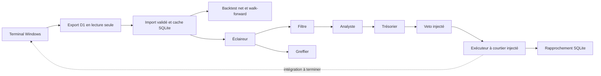

# Architecture

Le pipeline de recherche et l'exécuteur injecté sont séparés des lanceurs historiques.
L'ancien service Windows, son tableau et ses notifications continuent d'utiliser leurs
points d'entrée historiques. Les résultats de recherche ne changent pas le robot en service.
